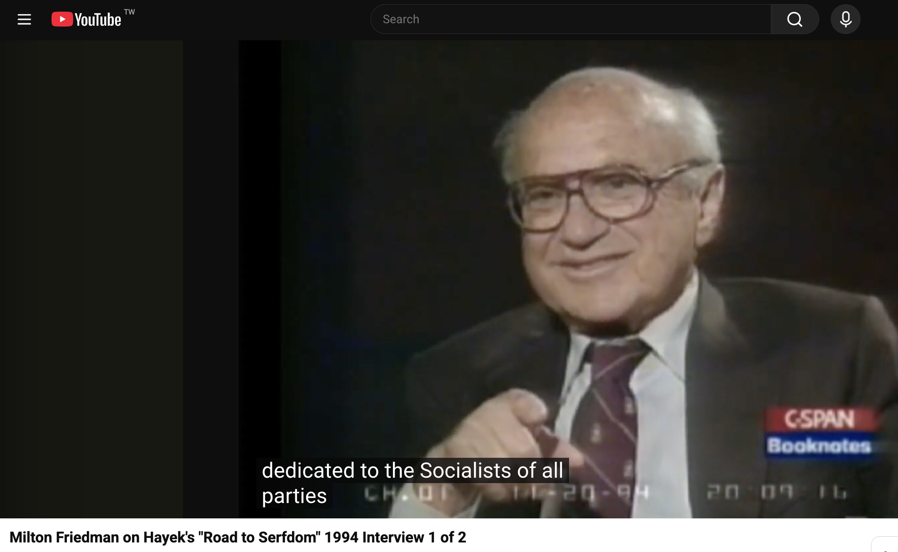
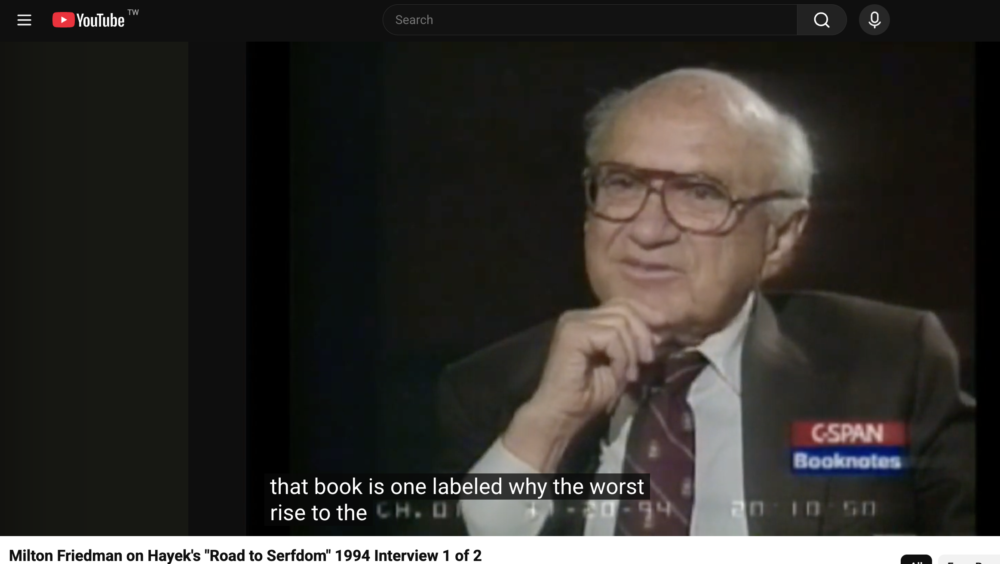

# 读《通往奴役之路》的一点感受

## 先吐槽

读《通往奴役之路》的起因是总看到有人拿哈耶克说事——说这个是通往奴役之路，说那个哈耶克早就警告过了，听着都挺像那么回事，但翻来覆去就那么几句。我想干脆自己读一遍，看看他到底说了什么。

读完《通往奴役之路》（The Road to Serfdom）和他的另一篇短文《知识分子与社会主义》（The Intellectuals and Socialism），我突然就想借用一下季羡林老先生在 《清华园日记》里的几句话 ，“就为了读这本书（*早晨只是上班* ）坐得腚都痛了”，“ 我读完（*我以为老叶不上班，他却去了，我没去*），不知放了些什么屁”  。据说当年编辑曾建议将这类俚俗粗话以及著名的“*考他娘的什么东西*”等直抒胸臆的句子删改，但老先生坚持一字不改、原样保留，并在后记中解释说：自己几十年前不是圣人，今天也不是圣人。

当然吐槽要文明点，这样吐槽就很没素质，书都白读了。所以我借用 布赖恩·卡普兰 ([Bryan Caplan](https://economics.gmu.edu/people/bcaplan)) 的话吐槽一下， 布赖恩·卡普兰是美国乔治梅森大学经济学教授，2009 年他写过一篇 [Two Takes on Hayek's Flabbiness](https://www.econlib.org/archives/2009/12/two_takes_on_ha.html)：

> I've long since lost all patience with Hayek. His original, true ideas could have been five good blog posts, his errors and bizarre obsessions are numerous, and his writing style insults every person who ever tried to write a decent sentence.

我对哈耶克早就一点耐心都没有了。他那些原创而且正确的想法，五篇像样的博客就能写完；他的错误和古怪的执念实在太多了；而他的文风，侮辱了每一个曾经努力想把一个句子写好的人。

客气一点的说法是1943年 Harper 出版社的经济学编辑 Ordway Tead 拒稿的理由：

> I do feel that the volume is labored, is over-written and that he can say all that he has to say in about half the space.
>
> 我确实觉得这本书写得吃力、过于冗长，他要说的一切，大约用一半的篇幅就能说完。

Tead 1943 年退稿信的第二条理由：

> Also, it is so completely in the negative vein as to leave the reader without any clue as to what line to take in thought or policy.
>
> 而且，它完全是否定性的，读者读完不知道在思想上或政策上该走哪条路。

其实可以更直白的说  leave the reader without any clue what he tried to say! 他到底要说什么？！

## 中文世界的常见误读

 中文世界里对这本书的误读实在太多，我列举这么几条：

### 「通往奴役之路，往往是善意铺就的」

这句我在很多地方都读到过，几乎成了这本书的标准注解。

但它压根不是哈耶克的话。**它是英谚 "the road to hell is paved with good intentions" 套上了这本书的书名。**哈耶克确实说过类似的意思，但他的原话是这样：

> The supreme tragedy is still not seen that in Germany it was largely people of good will, men who were admired and held up as models in the democratic countries, who prepared the way for, if they did not actually create, the forces which now stand for everything they detest. Yet our chance of averting a similar fate depends on our facing the danger and on our being prepared to revise even our most cherished hopes and ambitions if they should prove to be the source of the danger.
>
> 最大的悲剧至今仍未被看见：在德国，主要是那些心怀善意的人——那些在民主国家里备受景仰、被树为楷模的人——为如今代表着他们所憎恶的一切的那些力量铺平了道路，即便不能说是他们亲手造就了那些力量。然而，我们能否避免同样的命运，取决于我们是否敢于正视这一危险，以及是否准备好——哪怕是我们最珍视的希望与抱负，一旦被证明正是危险的来源——也要加以修正。

第一，**他讲的是德国这一个具体案例，完全没有泛化**。第二，**他紧接着就说了怎么避免**——那半句在中文文章里从来没出现过。第三，我觉得他这句是个反讽：**铺路的人和受害的人是同一批人**。改成"往往是善意铺就的"，这层就全没了，只剩一句四平八稳的道德箴言。

顺带说，第二章标题就叫 THE GREAT UTOPIA  开篇引用德国诗人 Friedrich Hölderlin 的话

> What has always made the state a hell on earth has been precisely that man has tried to make it his heaven.
>
> 历来使国家成为人间地狱的，恰恰是人试图把它变成人间天堂。

这句也常被当成哈耶克说的。而这一章真正的结论是：

> That democratic socialism, the great utopia of the last few generations, is not only unachievable, but that to strive for it produces something so utterly different that few of those who now wish it would be prepared to accept the consequences
>
> 民主社会主义——过去几代人的伟大乌托邦——不但无法实现；而且，为实现它所作的努力，会产生某种截然不同的东西，以至于今天希望它实现的人里，很少有人愿意接受那样的后果。

这跟"善意铺就"完全是两回事。

对于哈耶克在书里的引言，Hayek, F. A.. The Road to Serfdom: Text and Documents--The Definitive Edition 还补充一个有意思的注脚：

An editorial anecdote: the book is filled with quotations of others, and unfortunately, Hayek often failed to get the quotations exactly right, even those at the head of his chapters. In a letter dated February 26, 1944, Hayek asked Machlup to correct one of his quotes, Acton’s famous line, “Power tends to corrupt, and absolute power corrupts absolutely.” Unfortunately, even in his correction Hayek got it wrong, telling Machlup it should read, “Power tends to corrupt, and absolute power tends to corrupt absolutely”! Machlup dutifully passed the “correction” on, but presumably the actual quote was sufficiently famous that the Chicago Press copyeditor caught the error, for the correct phrasing appeared in the book. The letter is found in the Machlup Papers, box 43, folder 15, Hoover Institution Archives.

这本书里满是对他人的引用，而不幸的是，哈耶克常常引得不准确——连各章开头的题词也不例外。在 1944 年 2 月 26 日的一封信里，哈耶克请马赫卢普替他更正其中一处引文，即阿克顿那句名言："Power tends to corrupt, and absolute power corrupts absolutely."不幸的是，**他连自己的更正都弄错了**——他告诉马赫卢普，那句话应当作："Power tends to corrupt, and absolute power tends to corrupt absolutely”！马赫卢普尽职地把这份"更正"转呈了过去，但想必是因为这句话本身实在太有名，芝加哥大学出版社的文字编辑发现了这个错误，所以书上印出来的还是正确的说法。此信藏于胡佛研究所档案馆马赫卢普文库第 43 盒第 15 文件夹。

### 「集体主义必然走向极权」

这是更大的误读，因为**哈耶克本人在 1976 年再版序里专门否认过这句话**：

> It has frequently been alleged that I have contended that any movement in the direction of socialism is bound to lead to totalitarianism. Even though this danger exists, this is not what the book says. What it contains is a warning that unless we mend the principles of our policy, some very unpleasant consequences will follow which most of those who advocate these policies do not want.
>
> 人们常常指称，我主张任何朝社会主义方向的移动都必然导致极权主义。尽管这种危险确实存在，但这不是这本书所说的。这本书所包含的是一个警告：除非我们修正我们政策的原则，否则将会出现一些很不愉快的后果——而这些后果，是大多数鼓吹这些政策的人所不想要的。

这是一个**条件警告**："除非改，否则出事"，而不是一个预言。而这个误读的源头哈耶克本人指向了萨缪尔森那本教科书……不过 Caldwell 在脚注里补了一句：哈耶克这么说是不对的，这个误读本来就很普遍。**连他自己找误读的源头都找错了**：

> I am afraid in glancing through the 11th edition of your Economics I seem to have discovered the source of the false allegation about my book The Road to Serfdom which I constantly encounter, most resent and can only regard as a malicious distortion which has largely succeeded in discrediting my argument . . . [Y]ou assert that I contend that “each step away from the market system and towards the social reform of the welfare state is inevitably a journey that must end in a totalitarian state” and that “government modification of market laissez faire must lead inevitably to political serfdom.” . . .
>
> Hayek, F. A.. The Road to Serfdom: Text and Documents--The Definitive Edition (The Collected Works of F. A. Hayek, Volume 2) (pp. 28-29). (Function). Kindle Edition. 
>
> 在翻阅您《经济学》第 11 版时，我似乎发现了那个关于我那本《通往奴役之路》的虚假指控的源头——那个我不断遇到、极为反感、且只能视之为一种恶意曲解的指控；这种曲解在很大程度上已经成功地败坏了我的论证……〔您〕断言我主张"每一步偏离市场体系、走向福利国家式社会改革的举动，都不可避免地是一趟必然终结于极权国家的旅程"，并断言"政府对市场自由放任的修正必然导致政治上的奴役"

### 所谓「七大观点」

微信公众号**人文经济学堂**是一个我还算喜欢的公众号，但有一篇署名**韦森**（复旦大学经济学院教授）的《哈耶克〈通往奴役之路〉的 **7 大观点**》，第一条就是"市场经济是人类迄今所能发现的最有效率且较为理想的一种资源配置体制"。 我非常确认书里根本没提。

而且不是"没有这句话"这么简单——**"资源配置"这整套词汇在这本书里都不存在**，连"市场"这个词都很少用。我一开始以为是公众号自己瞎搞。后来查了一下，**同样的内容以韦森署名发在财新博客和澎湃上，是他本人的文章**。考虑到他写过《重读哈耶克》、通读全集，我倒不觉得这是造假。**更像是通读全集之后的记忆融合**——脑子里哈耶克是一个连续的整体，凭记忆调用的时候，跨书的边界就消失了。

### 我自己的三个引申

一，几个中译本都被吐槽晦涩难懂，其实不奇怪，书本身就难读。所以我也觉得，普通人读读美国读者文摘的缩编本就可以了——虽然哈耶克本人对缩编本有意见：

> But it is also clear (and quite understandable, given his personality) that Hayek was a bit embarrassed by all the adulation, especially from those who might have gotten their only knowledge of his views from a 20-page condensation (or worse, from the cartoon edition that had appeared in the February 1945 issue of Look magazine). He seemed particularly worried about being misinterpreted.
>
> 但同样清楚的是（考虑到他的性格，这也完全可以理解）：哈耶克对那些赞誉多少有些难堪，尤其当赞誉来自那些可能只从一份二十页的缩编本了解他观点的人——或者更糟，来自那些只看过 1945 年 2 月号《Look》杂志上那个漫画版的人。他似乎特别担心自己被误解。

二，国内对哈耶克的解读我还比较信张维迎。想读懂《知识分子与社会主义》，不如直接读他那篇《为什么知识分子会相信愚蠢的理念》。

三，如果真要说这本书有什么核心结论，我觉得就是书的最后一章 conclusion的最后一句话，也是**本书最后一句**，The guiding principle that a policy of freedom for the individual is the only truly progressive policy remains as true today as it was in the nineteenth century. 唯有以个体自由为核心的政策才是真正进步的政策，这一指导性原则在十九世纪成立，在今天依然如此。

## socialism 和 socialists

### 太多的意思被塞进这两个词里

我读这本书有个和别人不太一样的感受——至少我没读到有别人提这个疑问：**书里说的 socialism 和 socialists 到底指什么？**

比如开篇那句献词，**To the socialists of all parties**（致所有党派的社会主义者）。我上学的年代，社会主义就被简单粗暴地分成空想社会主义和科学社会主义。后来知道这是我们最喜欢的那种二分法，但也一直没细想过，直到读这本书。

书里对 socialism 的描述对我冲击很大，举几个例子。

第一章：

> Although we had been warned by some of the greatest political thinkers of the nineteenth century, by de Tocqueville and Lord Acton, **that socialism means slavery**…
>
> 尽管十九世纪一些最伟大的政治思想家——托克维尔和阿克顿勋爵——曾警告过我们，社会主义意味着奴役……

一个有意思的小细节，这本书有不少对托克维尔话的引用，1956 美国版的序言 （FOREWORD TO THE 1956  AMERICAN PAPERBACK EDITION）里甚至说书名和托克维尔有关 : "It was, incidentally, Tocqueville’s frequent reference to the “new servitude” which suggested the title of the present book. "

第二章：

> that **socialism has displaced liberalism** as the doctrine held by the great majority of progressives does not simply mean that people had forgotten the warnings of the great liberal thinkers of the past about the consequences of collectivism. The extraordinary thing is that the same socialism that was not only early recognised as the gravest threat to freedom, but quite openly began as a reaction against the liberalism of the French Revolution, gained general acceptance under the flag of liberty.
>
> 社会主义取代自由主义、成为绝大多数进步人士所奉持的学说——这件事并不仅仅意味着人们忘记了过去那些伟大的自由主义思想家关于集体主义之后果的警告。离奇之处在于：同一个社会主义，不但很早就被认出是对自由最严重的威胁，而且它一开始就公开地是对法国大革命之自由主义的一种反动——它却打着自由的旗号赢得了普遍接受。

第三章一开始

> It may mean, and is often used to describe, merely the ideals of social justice, greater equality and security which are the ultimate aims of socialism. But it means also the particular method… **In this sense socialism means the abolition of private enterprise, of private ownership of the means of production, and the creation of a system of "planned economy" in which the entrepreneur working for profit is replaced by a central planning body.**
>
> 它可以指、而且常被用来指社会正义、更大的平等、保障这些终极目标。但它同时也指某种特定的方法……**在这个意义上，社会主义指的是废除私营企业、废除生产资料私有制，并建立一种"计划经济"体制，其中追逐利润的企业家被一个中央计划机构所取代。**

同样在第三章 Individualism and Collectivism 的引用，来自 Élie Halévy，埃利·阿莱维，法国历史学家

> **The socialists believe in two things** which are absolutely different and perhaps even contradictory: freedom and organization.
>
> 社会主义者信奉两样绝然不同、甚至可能互相矛盾的东西：自由与组织。

第五章：

> And to make it quite clear that a **socialist government** must not allow itself to be too much fettered by democratic procedure,
>
> 而且，为了把话说得十分清楚：一个社会主义政府决不能让自己被民主程序束缚得太厉害，

第七章：

> In their wishful belief that there is really no longer an economic problem people have been confirmed by irresponsible talk about "potential plenty"—which, if it were a fact, would indeed mean that there is no economic problem which makes the choice inevitable. But although this snare has served **socialist propaganda** under various names as long as socialism has existed, it is still as palpably untrue as it was when it was first used over a hundred years ago.
>
> 人们一厢情愿地相信经济问题真的已经不复存在，而关于"潜在的富足"的那些不负责任的说法又强化了这种信念——倘若那真是事实，就的确意味着不再存在那种使取舍成为必然的经济问题。但这个圈套虽然自社会主义诞生之日起就以各种名目为社会主义宣传效力，它今天仍然像一百多年前初次被使用时一样，明显地不真实。

实在太多这样的描述，没法一一举例。所以，老先生，您说的 socialism 到底是什么……

当然有一点可以肯定：他笔下的 socialism 一定不是、或者不只是我们熟知的马克思定义的那个 socialism，也不只是教科书里的空想社会主义（Utopian socialism）所指那些。

我大概能读出他把这五重意思都塞进了 socialism 里：

1. **生产资料公有制** —— 这个是显然的
2. **中央计划经济** —— 第三到第七章的操作性定义
3. **平等主义的再分配目标** —— 他自己在第三章区分过"目的"和"手段"：社会正义、更大的平等、保障
4. **集体主义／反个人主义** —— 第十二、十三章
5. **相信社会秩序必须被有意识地设计** —— 这一条要多读几遍才能感觉出来，而且研究哈耶克的权威专家 Bruce Caldwell 在 *The Road to Serfdom after 75 Years* 里也明确说了这点。

更有意思的是，哈耶克 1956 年为美国版专门写的那篇前言里说：

> although I recognize that the **hot socialism** against which it was mainly directed—that organized movement toward a deliberate organization of economic life by the state as the chief owner of the means of production—is nearly dead in the Western world. The century of socialism in this sense probably came to an end around 1948. Many of its illusions have been discarded even by its leaders, and elsewhere as well as in the United States the very name has lost much of its attraction.
>
> ……尽管我承认，本书主要针对的那种"狂热社会主义"——即那场有组织的运动，主张由作为生产资料主要所有者的国家来刻意组织经济生活——在西方世界已近乎死亡。在这个意义上的社会主义世纪，大概在 1948 年前后就结束了。它的许多幻想连它自己的领袖都已经抛弃；在美国以及别的地方，这个名称本身也已丧失了大部分吸引力。

**既然有 hot socialism 了，那还有什么别的 socialism？**

### Socialism in Britain owed more to Methodism than to Marx.

带着这个困惑，我自己做了点研究，找到一句很有意思的话： Socialism in Britain owed more to **Methodism** than to Marx, 英国的社会主义受惠于卫理公会的多于受惠于马克思。这句话一般归给 1950 年代工党总书记 Morgan Phillips。**Methodism** 卫理公会式的社会主义说资本主义是错的——贪婪和剥削是罪(sin) 。这是伦理判断，但他们根本不认可阶级斗争那一套；在上帝面前人人平等，灵魂平等，人格平等。

一点小科普: **"socialist"这个词 1827 年首次出现在英语里**：罗伯特欧文被称为英国的社会主义之父， [Robert Owen, Father of British Socialism](https://www.historic-uk.com/HistoryUK/HistoryofWales/Robert-Owen-Father-British-Socialsm/) ，他论述的社会主义就是被我们抨击的“空想社会主义” Utopian Socialism.  **欧文派 Owenites** 的《合作杂志》（The Co-operative Magazine）是19世纪20年代英国空想社会主义与合作社运动史上一份极具里程碑意义的定期刊物，在词源学和思想史上最著名的贡献是首次在英文印刷品中使用了“社会主义者”（Socialist）一词。 所谓欧文派就是受这位威尔士纺织业主、社会改革家罗伯特·欧文（1771–1858）启发而形成的那一批社会改革运动、集体公社和合作社组织。而抽象名词「社会主义」（socialism）要晚十年左右，约 1837 年才出现。

所以，英语里的 socialism 是本土产物，诞生时和马克思毫无关系；马克思主义要到几十年后才影响到英国劳工运动，而且影响有限。而socialism当时的意思是欧文用的那个：用"the social system"（社会体制）对照 "the individual system"（个人体制）。 也就是说，五个意思里的第 4 义（反个人主义）才是这个词的本义，第 1 义（生产资料公有）反而是后来加上去的技术义，顺序是反的。

卫理公会式的社会主义的思想来源和马克思的论述完全不同：

- 批判的性质是**罪 (sin)**，不是矛盾——贪婪和剥削是道德错误，不是历史规律
- **社会变革靠改变人的良心，不靠历史的铁律**。所以英国社会主义是渐进的、劝说式的
- 在上帝面前人人平等 → 灵魂平等 → 人格平等。俗人传道意味着一个矿工可以向他的"上等人"布道
- 关键词是 **fellowship**（团契），不是 class struggle
- 而且这一支的组织形式是合作社、互助会、工会——**自愿结社，不是国家所有制**

凯尔·哈迪、阿瑟·亨德森这些早期工党领袖都是俗人传道士，读过《资本论》的是少数。**工党从未把马克思主义定为党纲。**

### Fabian Society（费边社）

和《资本论》几乎同一时期的社会主义运动形式是成立于 1884 年Fabian Society（费边社），它的第一份纲领明确写着要把土地和产业资本从个人和阶级手里转为社会所有。相对于同时期的马克思主义组织主张的资本主义会在危机中崩溃，工人阶级夺权接管的方式，费边社明确表示拒绝！费边社的名字取自罗马将军费边·马克西姆斯，绰号"拖延者"——他打汉尼拔的办法是坚决不决战，靠消耗。**这个名字本身就是纲领**：拒绝革命，靠时间取胜。费边社的核心人物：西德尼与比阿特丽斯·韦伯夫妇、萧伯纳、格雷厄姆·华莱士；费边社的核心主张是**"渐进的必然性"**（the inevitability of gradualness，西德尼·韦伯语）。社会主义不是夺取政权的事，是一项项立法、一个个市政公营、一份份专家委员会报告累积出来的。

费边社的路线是三条：

**一，从地租理论出发，而不是从剩余价值出发。** 他们运用的是大卫李嘉图和约翰穆勒的英国政治经济学，不是马克思。论证大意是：地租和资本收益是**不劳而获的差额**，社会完全可以通过税收和公有把它收回来，不需要砸烂任何东西。

**二，社会主义正在自己到来。** 韦伯的著名观察：市政当局已经在办自来水、煤气、电车、医院、学校了。那就是社会主义在发生，只是没人这么叫它。所以要做的是**加速和扩展一个已经在走的过程**，社会主义的到来不靠夺取政权，是**"渐进的必然性"**。

**三，渗透（permeation）。**  不组织群众，不上街，不建自己的党。写小册子、做调查、进委员会、影响有权起草法案的人。费边社历史上人数一直很少——几千人——但影响力远超规模，因为他们瞄准的是**写字的人和管事的人**。费边社推崇**专家治理。** 韦伯夫妇真正相信的是：社会问题可以通过调查、统计、行政设计来解决，而做这件事的应该是受过训练的人。他们一生在做社会调查，写《工会主义史》《英国地方政府史》这种大部头。

所以哈耶克在英国面对的两翼——卫理公会这一支和费边社那一支——都不是马克思主义者。卫理公会这一支对应的是我总结的**第 3 含义**，费边社这一支对应**第 1、2、5 义**。

关于费边社还有一个挺有意思的背景：费边社 1895 年创办了**伦敦经济学院**，目的就是培养即将到来的集体主义国家所需要的行政官员；而哈耶克 1931 年到 1950 年在这所学校教了近二十年书。**他是在对手创办的学校里，花了二十年写一本反对他们的书。**

## 最好的章节和最弱的章节

回到这本书本身，我个人觉得最好的是第六章 **Planning and the Rule of Law**. 这一章的评论网上很多，我就不展开了，就强调一点：它给出的判准不是"政府该不该管"，而是"政府依据的是事先公布的一般规则，还是针对特定对象的裁量"。这条尺子拿在手里，看很多事情会清楚很多。

重点说一下 我觉得论证最弱的是第十章 **Why The Worst Get On Top**

这一章里有一句我印象极深：

> It seems to be almost a law of human nature that it is easier for people to agree on a negative program—on the hatred of an enemy, on the envy of those better off—than on any positive task. The contrast between the "we" and the "they," the common fight against those outside the group, seems to be an essential ingredient in any creed which will solidly knit together a group for common action.
>
> 这似乎几乎是一条人性的法则：人们更容易就一个否定性的纲领达成一致——对一个敌人的仇恨，对境况更好者的嫉妒——而不是就任何肯定性的任务达成一致。"我们"与"他们"的对立，共同对抗群体之外的那些人，似乎是任何能把一群人牢固地拧在一起以采取共同行动的信条中，不可或缺的成分。

这句话我觉得是全书最经得起时间检验的观察，**最现成的例子就是川普**——他把"我们"和"他们"的对立用得极其熟练。 问题在于——从这句话怎么推出"最坏者当政"？我觉得这一步就不成立。 而且川普例子恰恰说明这个机制在市场民主国家照样运转，**所以它不能用来证明"计划"会特别地筛出坏人**。

看哈耶克自己那句总纲："有三个主要原因，使得这样一个人数众多、意见相当一致的集团，不太可能由一个社会中最好的分子构成，而更可能由最坏的分子构成“。他说的是这个集团**由**什么人组成，也就是**基座**。而标题问的是谁爬到**塔尖**。基座的成分推不出塔尖的品性。中间需要一步论证，而哈耶克没给。

There are three main reasons why such a numerous and strong group with fairly homogeneous views is not likely to be formed by the best but rather by the worst elements of any society. By our standards the principles on which such a group would be selected will be almost entirely negative.

## 和Bruce Caldwell 信件沟通

Bruce Caldwell 是当今研究哈耶克的权威专家，也是《哈耶克全集》的主编。他有一个访谈讲到 90 年代他怎么赢得哈耶克子女的信任，得以读到大量私人信件 （他在 YouTube 上谈哈耶克的视频也值得看看）。他写的哈耶克传记 *Hayek: A Life, 1899–1950* 有 824 页，我肯定不可能读完。但他为《通往奴役之路》定本写的编者导言，以及 [*The Road to Serfdom after 75 Years*](https://www.aeaweb.org/articles?id=10.1257/jel.20191542)，很值得读一读。

我浏览[他的主页](https://sites.duke.edu/brucecaldwell/)时看到他留了邮箱地址，突然想不妨问问。就我自己的经验，只要你是真诚地想沟通，不是要套瓷，对方通常都很愿意回答。比如我给彼得·海斯勒写信提对他《另一条河》(Other Rivers) 的看法，他也很快就回复了。

所以不出所料，邮件发出后很快就有了回音：

> What a surprising and interesting e-mail to receive this weekend!
>
> Hayek was of course fully aware of the standard definition, nationalization of the means of production, and of the various forms of "market socialism" being discussed at the time. But in a popular book he was also trying to deflate a bit the great claims that were being made for scientific planning. So all of those were targets. His dedication was meant to indicate that, I think.
>
> So I agree with you that there are many targets in the book, not just socialism in the strict sense.
>
> You probably have already looked at other of his writings, but if not his introductory and concluding essays in his 1935 book *Collectivist Economic Planning*, his 1940 *Economica* review of Lange's and Dickinson's books, "Socialist Calculation: The Competitive 'Solution'," and finally "Scientism and the Study of Society," reprinted in *The Counter-Revolution of Science* (1952), are also quite useful. If you have access to the *Collected Works of F. A. Hayek* series that I edited, the essays on socialism are in volume 9 (*Socialism and War*) and on scientism in volume 13 (*Studies on the Abuse and Decline of Reason*).
>
> 这个周末能收到这样一封邮件，真是既意外又有意思！
>
> 哈耶克当然完全清楚那个标准定义——生产资料国有化——也清楚当时正在讨论的各种形式的"市场社会主义"。但在一本面向大众的书里，他同时也想给当时那些关于"科学的计划"的宏大主张泄一点气。所以这些全都是他的靶子。我想，他那句献词就是要表明这一点。
>
> 所以我同意你的看法：这本书里有很多个靶子，不只是严格意义上的社会主义。
>
> 你大概已经读过他别的著作了；如果还没有，以下这些也很有用：他 1935 年《集体主义经济计划》一书的导论和结论两篇文章；他 1940 年在 *Economica* 上评兰格与迪金森两本书的《社会主义计算：竞争性的"解决方案"》；以及《唯科学主义与社会研究》，重印于《科学的反革命》(1952)。如果你能找到我编的《哈耶克全集》，关于社会主义的文章在第 9 卷（《社会主义与战争》），关于唯科学主义的在第 13 卷（《对理性之滥用与衰落的研究》）。

后面又补了一封短的：

> As you suggest, it was not chiefly to Marx – Fabian socialists in England did not like Marx's labor theory of value. Your final paragraph gets at some of it.
>
> Good luck with your reading.
>
> 正如你所指出的，它主要不是冲着马克思去的——英国的费边社会主义者并不喜欢马克思的劳动价值论。你最后那一段说到了一部分要害。
>
> 祝你阅读顺利。

对于结尾那句 Good luck with your reading，我特别想用 Bryan Caplan 的话回：I've long since lost all patience with Hayek. **I am done with Hayek.**

## 推荐几个 youtube 视频

1. [Hayek and 𝙏𝙝𝙚 𝙍𝙤𝙖𝙙 𝙩𝙤 𝙎𝙚𝙧𝙛𝙙𝙤𝙢](https://www.youtube.com/watch?v=V6kxypNWZvM&t=28s) Bruce Caldwell  老先生 2024年的一个 16分钟的讲座，谈到哈耶克写这本书的动机，当然有关于 socialism的论述，包括费边社。  
2. [Who Is Friedrich Hayek?](https://www.youtube.com/watch?v=GydeSeyJ16k) Bruce Caldwell  老先生 2023年的一个 21分钟的讲座，解释哈耶克生平还有他写哈耶克专辑过程。  
3. [Milton Friedman on Hayek's "Road to Serfdom" 1994 Interview](https://www.youtube.com/watch?v=15idnfuyqXs&t=770s) 经济学大师弗里德曼 Milton Friedman 两段节目，各29分钟。在第6分50秒时候一个有趣对话，弗里德曼说 "one of the interesting things about the book is whom he is dedicated **To the socialists of all parties**" lol .   
   不过 弗里德曼认为这本书 **the most interesting chapter** （在第9分钟左右）恰恰是我觉得论证最弱的是第十章 Why the worst get on top, 而他的理由是这是"绝对权力导致绝对腐败"的一个例证,  "if you're given power and you have to exercise it, you are driven by that necessity to do things that many people really would object to doing and only those people who are willing to behave in a public capacity differently than they would behave in their private capacity are ever going to make it to the top" (如果你被赋予了权力，而且你不得不行使它，那么这种不得不就会驱使你去做许多人其实并不愿意做的事；而**只有那些愿意在公职身份上做出与私人身份下不同行为的人，最终才爬得上顶端**。)   

   我觉得他这个理由有点牵强，他说的理由肯定没法说明为什么最差的人爬到最顶上，而且说的也不是同一件事。  
4. [Bruce Caldwell "F.A. Hayek: Life and Legacy"](https://www.youtube.com/watch?v=QpHu8e2-8wc&t=3718s) 这个视频有1小时23分钟。  

## 最后

这本书值不值得读？对于像我这样**普通人**，我会说如果你有充裕的时间，又喜欢跟人抬杠：”不，哈耶克没说过这样的话“ 或者”不，哈耶克没这个意思“ 或者你突然冒出要不去看看”牛来“这个烂片到底有多烂，那你就读读；不然生活还有很多有意思的事。

